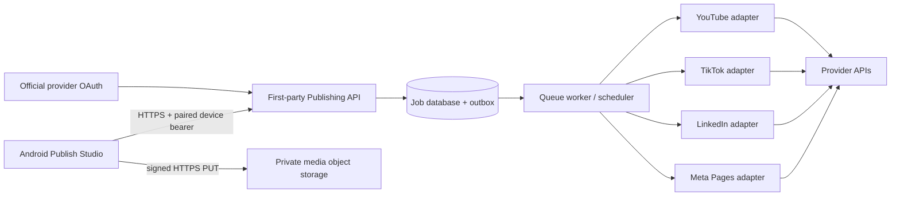

# Schedule & Publish: architecture and rollout

## Product shape

The publish studio is a dedicated destination from the home screen and editor, separate from capture/editing. Its three top-level sections are **Queue**, **Calendar**, and **Accounts**. Queue distinguishes drafts saved only on the phone from jobs acknowledged by the publishing service. Calendar groups both kinds by the viewer's timezone and labels local drafts clearly. Accounts explains the destination and required access for each provider, then hands sign-in to the provider's official browser authorization page. The composer selects an exported video, shared caption, one or more channels, per-channel settings, and either a future local date/time or Publish now.

Each channel is checked independently by the service. A single user action can create a parent submission with one child delivery job per provider, so one provider rejecting a post does not erase successful or pending deliveries to the other channels. The composer must eventually show per-channel limits and validation errors before submission; provider APIs remain authoritative for rules that vary by account, region, and API review status.

## System boundaries

The Android client stores only the publishing-service URL (set by the app build, never by creators), local drafts, OAuth state nonces, an app-generated installation ID, and an encrypted first-party device session. The session is encrypted using an Android Keystore AES/GCM key and can be revoked server-side. First account connection starts OAuth directly; after the provider sign-in, the service exchanges a one-time callback ticket for the device session, so creators do not need a pairing website or code. Provider access and refresh tokens, client secrets, scheduled job execution, media conversion, and provider API calls stay on the service. Video data goes directly from the phone to a short-lived signed storage URL; the API receives metadata and never proxies multi-gigabyte uploads through an application server. The object remains private, is encrypted at rest, and is deleted by retention policy after all child jobs are terminal plus a configured recovery period.

The worker uses a transactional outbox, provider-specific idempotency keys where supported, and a durable delivery record per destination. It records resumable upload state, provider post IDs, retry count, next retry time, and sanitized provider errors. Exponential backoff applies to transient network failures and rate limits; expired authorization moves a destination to `needs_reconnect`; invalid media, permission, or policy errors become `needs_attention` and are not retried automatically. Cancellation is supported only before a provider has accepted/published the post, unless that provider documents deletion support and the user explicitly chooses it.

## Android-to-service API contract (v1)

Base path: `/v1`. All endpoints except `/health`, initial account OAuth start, and initial OAuth completion require `Authorization: Bearer <device-session>`. Production service URLs and signed upload URLs must use HTTPS. JSON errors use `{ "code": "...", "message": "...", "requestId": "..." }`; never return provider tokens or raw secrets. The Android client code is in `app/src/main/java/studio/solocamera/PublishApiClient.java`; the publish UI and local draft lifecycle are in `PublishActivity.java` and `PublishDraftStore.java`.

| Endpoint | Purpose | Required behavior |
| --- | --- | --- |
| `GET /health` | Test URL and service version | Public, no account data |
| `POST /mobile/oauth/start` | Start first-account authorization without an existing device session | Body: provider and app-generated deviceId; rate limited; create short-lived, single-use PKCE/state bound to provider and deviceId; return `authorizationUrl` and state |
| `DELETE /mobile/sessions/current` | Revoke this device | Invalidate immediately |
| `GET /accounts` | List connected provider destinations and capability metadata | Return Page/org/member destinations, scopes, reconnect status, and TikTok creator privacy choices when available |
| `POST /oauth/{provider}/start` | Start authorization | Create expiring, single-use, PKCE-protected state bound to this session; return `authorizationUrl` and state |
| `GET /oauth/{provider}/callback` | Provider redirect | Validate state, exchange code server-side, encrypt provider tokens, enumerate eligible destinations, then redirect to `solocamera://oauth/callback?provider=…&state=…&ticket=…` with a single-use, short-lived callback ticket (never put provider authorization codes in the app link) |
| `POST /mobile/oauth/complete` | Finish first authorization and establish device session, or bind another account to an existing session | Body: provider, state, callbackTicket, deviceId; validate state/ticket atomically; on first connection return `accessToken`, `expiresAt`, `deviceId`; later connections require the existing bearer session |
| `POST /uploads` | Create private object and signed upload | Body: `fileName`, `contentType`, `sizeBytes`; response: `uploadId`, `uploadUrl`, `headers`, `expiresAt`, `maxBytes` |
| `POST /uploads/{id}/complete` | Finalize and inspect media | Validate actual bytes, file signature, duration, dimensions, codec; return normalized media metadata |
| `POST /publishing/jobs` | Validate and enqueue child deliveries | Body has `uploadId`, `channels`, epoch-ms `scheduledAt` or null, IANA `timeZone`, and `idempotencyKey`; response must include stable `jobId`, state, and per-channel results |
| `GET /publishing/jobs` | List jobs and recent outcomes | Cursor-paginated; filters for scheduled, processing, published, failed |
| `GET /publishing/jobs/{jobId}` | Refresh a job | Include per-channel state and provider post URL/ID when allowed |
| `POST /publishing/jobs/{jobId}/cancel` | Cancel a queued job | Return conflict once any provider has passed its cancellation boundary |
| `POST /publishing/jobs/{jobId}/retry` | Retry eligible failed channel deliveries | Preserve published destinations; enqueue only retryable failures |

The API currently implemented by the Android client calls the account, first/subsequent OAuth start and completion, upload-init/complete, job-create, and job-list routes. The upload PUT is explicitly HTTPS and uses the signed headers; the client requires the service to report the uploaded media as `ready` after inspecting it before it creates a publishing job. Before first real deployment, the service must add refresh and cancellation controls, pagination, lifecycle polling/webhooks, and robust provider workers described above. No publishing service repository or URL exists in this Android project yet; the creator app says the feature is being prepared until the first-party service is deployed.

### Job states

`draft` (device only) → `validating` → `scheduled` or `publishing` → per-provider `published`, `failed`, `needs_reconnect`, `needs_attention`, or `cancelled`. Parent state is `scheduled` while all deliverable children await future times; `publishing` while any child runs; `partial` when children end in mixed success/failure; and terminal `published`, `failed`, or `cancelled` when all children are terminal. The client removes a local draft only after the service returns a stable job ID. Network errors retain the draft and same idempotency key for a safe retry.

## Provider adapters and constraints

| Provider | Destination model | Server-side delivery path |
| --- | --- | --- |
| Facebook | Eligible Facebook Pages, not personal profile timelines | Meta OAuth and Page permissions; enumerate Pages; upload/publish Page video/Reel through the supported Graph API flow. Keep Page token server-side. |
| LinkedIn | Member feed or eligible organization page | 3-legged OAuth; request `w_member_social` or `w_organization_social`; upload video through the Videos API, then create the post through Posts API using the video asset URN and the selected author. |
| TikTok | Creator account and the privacy choices returned for that creator | Query creator info before posting; use Direct Post with approved `video.publish`, upload to returned URL, then poll status. Use the service scheduler for future posting and execute Direct Post at the due time. |
| YouTube | Channel | Resumable `videos.insert` upload; use private visibility and `status.publishAt` for a future release when eligible. Keep upload processing and privacy state visible; API projects that have not passed YouTube's audit may be restricted to private uploads. |

For TikTok and any provider without a dependable native scheduled-publication feature for the app's access tier, the service owns the durable schedule and performs the publish call at the requested time. The UI must never promise a schedule if only a device-local draft exists. Platform policy changes and app-review requirements are enforced in the service adapter and account capability response rather than hard-coded assumptions in the Android UI.

## Rollout sequence

1. **Android shell (implemented):** Publish Studio entry from home and editor; Queue/Calendar/Accounts; local draft persistence; video selection; cross-post composer; channel settings; future time picker; browser OAuth launch/callback state verification; first-account authorization bootstraps the encrypted app session without requiring pairing codes; signed upload progress; job submission/list; explicit local-draft vs service-confirmed states. Service URL configuration is hidden from creator UI and remains a developer-only debug option until the production endpoint is set in the app build.
2. **Service foundation (required next):** deploy API, database, object storage, task queue, worker, audit logs, and operational monitoring. Add retention, encryption, deletion, rate limits, abuse controls, and per-device revocation.
3. **Provider onboarding:** register apps in Meta, LinkedIn, TikTok, and Google consoles; configure redirect URLs and scopes; complete required product reviews/audits; add secrets to the service's secret manager. Add staging accounts for all four networks.
4. **Provider certification:** test OAuth expiry/reconnect, all media constraints, scheduled execution, retries, partial cross-post failure, cancellation races, quota/rate limiting, upload interruption, duplicate requests, daylight-saving/time-zone boundaries, and provider webhooks/polling.
5. **Production rollout:** enable providers independently using server capability flags; monitor upload cost, queue lag, error rate, provider API changes, battery/network impact on the phone, and media retention. Do not show a provider as ready until its review and delivery tests pass.

## External setup still needed

Real public publishing cannot be enabled by Android code alone. The owner must supply or configure the four developer applications, approved products/scopes and callback URLs, business/page access, Google API project audit where public YouTube visibility is needed, and a deployed HTTPS publishing service with object storage and a worker. Secrets belong in the service secret manager and must not be committed or entered in the Android app. The client deliberately has no embedded provider credentials and currently has no production endpoint configured.
